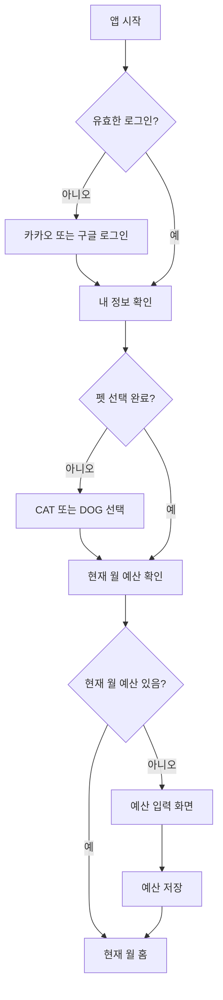
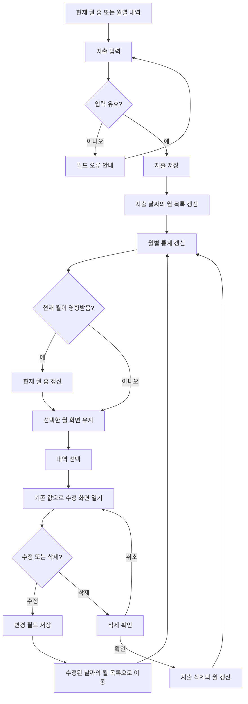
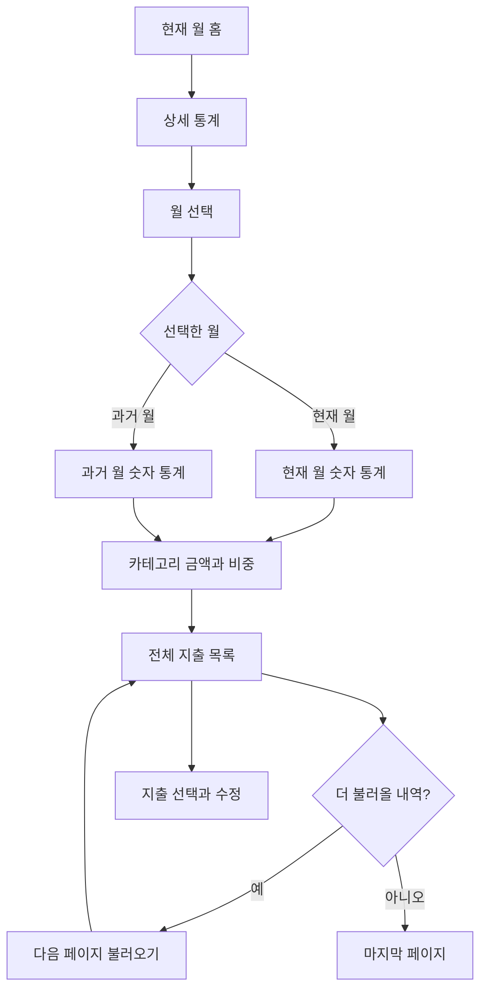

# 유저플로우: Petgyebu 리뉴얼 MVP

- 갱신: 2026-10-10
- 대상: `petgyebu_backend_renewal` 백엔드와 연결되는 앱
- 기준: [개발 기준](00-renewal-development-guide.md), [PRD](01-prd.md), [기능명세](02-requirements-features.md)
- 디자인 참고: [사용자 흐름 FigJam](https://www.figma.com/board/viSG5enjuib5thvwwIUY0m), [8개 화면 와이어프레임](https://www.figma.com/design/Ttkey5th2ALEig6hI1IWrz)

이 문서는 사용자가 화면 사이를 어떻게 이동하고, 각 행동 뒤 무엇을 다시 보여줘야 하는지 정한다. API 필드·상태 코드의 세부 계약은 `00-renewal-development-guide.md`를 따른다.

## 1. 앱 시작과 현재 월 진입

앱은 저장된 로그인으로 시작할 때 유효한 토큰을 사용하고, 액세스 토큰이 만료됐으면 유효한 리프레시 토큰으로 갱신한다. 갱신할 수 없으면 로그인 화면으로 돌아간다. 소셜 로그인에 성공해도 펫 선택과 **현재 월 예산 설정**을 마치기 전에는 홈으로 이동하지 않는다. 펫과 예산이 모두 없다면 펫을 먼저 선택한다.

새 달에 현재 월 예산이 없으면 직전 달 예산을 입력란에 제안한다. 사용자가 그대로 확인하거나 금액을 바꿔 저장해야 그 달 예산이 만들어진다. 이전 예산의 자동 복사나 월 전환 배치는 없다. 직전 달 예산이 없으면 제안할 금액도 없다.

홈의 정보 순서는 **펫 상태 → 예산 잔액·사용률 → 지출 기록**이다. 지출이 0건이면 `STABLE`과 첫 기록 안내를 보여준다. 사용자가 예산을 수정하면 현재 지출 합계는 유지하고 잔액·사용률·펫 상태를 갱신한다.

## 2. 지출 입력과 정정

- 입력 화면은 금액·날짜·카테고리·선택 메모를 받는다. 날짜는 오늘로 미리 채운다. 사용자가 카테고리를 고르지 않으면 `OTHER`로 저장하고, 미래 날짜는 받지 않는다. 메모는 최대 100자다.
- 저장 후 해당 날짜가 속한 월의 목록과 통계를 다시 조회한다. 현재 월이 영향받으면 홈도 다시 조회한다. 수정으로 날짜가 다른 월로 이동했다면 **이전 월과 새 월을 모두 갱신**한다.
- 수정 화면은 입력 화면을 재사용하면서 기존 값을 채운다. 수정한 뒤에는 바뀐 날짜가 속한 월의 목록으로 이동한다. 삭제 동작은 수정 화면에만 두고, 삭제 전에는 확인한다.
- 메모를 지우면 목록 제목은 카테고리 이름이다. 메모가 있으면 그 메모가 제목이고 날짜·카테고리가 보조 정보다. 금액은 항상 보인다. 긴 메모는 목록에서 한 줄로 줄이고 수정 화면에서 전체를 볼 수 있다.
- 같은 날짜·금액·카테고리의 지출을 여러 건 기록할 수 있다. 전체 취소는 삭제, 일부 환불은 금액 수정으로 처리한다.

## 3. 월 선택과 상세 통계

상세 통계는 **월 선택 → 지출 총액·건수 → 카테고리별 금액·비중 → 전체 지출 내역** 순서다. 카테고리는 지출이 있는 항목만 금액 내림차순으로 보여주고 동률이면 고정 카테고리 코드 순서를 따른다. 최대 일곱 항목은 일반 세로 스크롤로 보고, 지출 목록은 무한 스크롤로 이어서 불러온다.

월 선택기에는 현재 월과 모든 과거 월을 제공한다. 지출이 없는 달도 선택할 수 있으며 0원·0건과 빈 목록을 보여준다. 미래 월은 선택할 수 없다. **과거 월에는 펫 이미지·표정·상태가 없다.** 과거 월의 예산은 조회만 가능하다. 예산이 없다면 예산·사용률·잔액은 미설정으로 표시하고 지출 통계는 보여준다. 예산 설정·수정은 현재 월에서만 한다.

목록은 날짜 내림차순, 같은 날짜는 ID 내림차순이다. 첫 페이지와 추가 페이지의 로딩, 빈 목록, 불러오기 실패 후 재시도, 마지막 페이지를 구분한다. 월을 바꾸거나 지출을 생성·수정·삭제하면 기존 이어보기 표식을 버리고 첫 페이지부터 다시 불러온다. 추가 내역이 없으면 더 요청하지 않는다.

## 4. 설정과 계정 종료

설정에서 CAT·DOG 종류를 바꾸면 현재 홈의 펫 종류만 갱신한다. 지출·예산과 과거 월 숫자는 바뀌지 않는다. 로그아웃하면 서버의 현재 로그인을 무효화하고 앱의 토큰을 지운 뒤 로그인 화면으로 이동한다. 다른 기기에서 같은 계정으로 새로 로그인해 기존 로그인이 무효화되거나 리프레시 토큰이 만료되면 다시 소셜 로그인한다. 회원 탈퇴는 탈퇴 의사를 확인받은 뒤 계정·지출·예산을 삭제하고 로그인 화면으로 이동한다.

## 5. 화면별 빈 상태와 오류

| 화면·상황 | 사용자에게 보여줄 내용과 이동 |
|---|---|
| 로그인 실패·만료 | 카카오·구글 로그인 재시도. 인증이 만료된 기존 세션은 로그인 화면으로 이동 |
| 펫 미선택 | CAT·DOG 선택 화면. 예산도 없다면 펫 선택 후 예산 화면 |
| 현재 월 예산 미설정 | 직전 달 예산이 있으면 제안값을 채운 예산 화면. 사용자가 저장한 뒤 홈 |
| 현재 월 지출 0건 | 안정 상태, 지출 합계 0원, 첫 기록 안내 |
| 과거 월 지출 0건 | 총액 0원·건수 0건, 빈 카테고리와 빈 내역. 펫 없음 |
| 과거 월 예산 미설정 | 지출 통계 유지, 예산·사용률·잔액은 미설정. 과거 예산 수정 동작 없음 |
| 지출 입력 오류 | 해당 필드를 안내하고 입력값을 유지. 수정의 금액·날짜·카테고리 `null`은 오류 |
| 목록 추가 로딩 실패 | 이미 불러온 항목은 유지하고 재시도 동작 제공 |
| 지출 삭제 취소 | 수정 화면과 기존 지출 유지 |

## 6. 관련 API와 수용 기준

| 흐름 | 사용 API |
|---|---|
| 로그인·유지·종료 | `POST /api/v1/auth/login/{provider}`, `/api/v1/auth/refresh`, `/api/v1/auth/logout` |
| 펫·계정 | `GET /api/v1/users/me`, `PUT /api/v1/users/me/pet`, `DELETE /api/v1/users/me` |
| 현재 홈·예산 | `GET /api/v1/home`, `GET/PUT /api/v1/months/{month}/budget` |
| 지출 입력·수정 | `POST /api/v1/expenses`, `GET/PATCH/DELETE /api/v1/expenses/{expenseId}` |
| 월별 내역·통계 | `GET /api/v1/months/{month}/expenses`, `GET /api/v1/months/{month}/stats` |

1. 신규·새 달 사용자는 펫과 해당 현재 월 예산을 확정한 뒤에만 홈에 들어간다.
2. 지출 입력·정정 뒤 해당 월 목록·통계가 갱신되고 현재 월이 영향받으면 펫 상태도 갱신된다. 날짜가 월을 넘으면 두 월이 갱신된다.
3. 현재 월은 펫과 숫자를 함께, 과거 월은 숫자만 보여준다. 과거 월 지출은 조회·수정·삭제할 수 있지만 과거 예산은 수정할 수 없다.
4. 빈 월과 예산 없는 과거 월도 선택해 볼 수 있으며 목록의 추가 로딩·종료·재시도가 구분된다.
